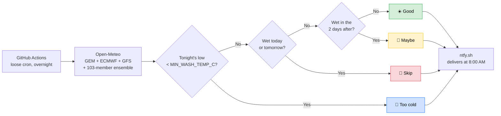

<h1 align="center">Car Wash Time</h1>

  <strong>Know whether it's worth washing the car before the next rain or snow.</strong>

  A GitHub Actions workflow that checks the forecast every morning and pushes a go / maybe / skip verdict at 8:00 AM.

  
  
  

  

---

## Why This Exists

My car is parked outside year-round. Through a Canadian winter that means road salt, slush, and freezing rain — a wash is only worth paying for if there's a clear stretch before the next storm coats everything again. The same logic applies to rain in the warmer months. Rather than checking the forecast manually every time I drive past a wash, this sends a verdict every morning so the decision is already made.

## What You'll Get

Every morning at 8:00 AM local time, a push notification with one of four verdicts. The title is the call; the body is one short line of context: what's coming, when it clears, or how cold.

| Verdict | Notification |
|---|---|
| **Good** | ☀️ Good day for a wash _Dry today and the next 3 days. Go for it._ _Dry for the next 5 days. Go for it._ _Dry all week. Go for it._ |
| **Maybe** | 🤔 Maybe wash it _Dry today and tomorrow, then rain Sun (60% chance). Your call. Next dry stretch: Mon onward (4 days)._ |
| **Skip** | 🚫 Skip the wash _Rain today (80% chance), wait it out. Next dry stretch: tomorrow onward (6 days)._ |
| **Too cold** | 🥶 Too cold for a wash _Tonight drops to -12°C; a fresh wash would freeze on the car._ |

"Good" means the rest of today (from 8 AM) and the next three days all look dry. "Skip" means rain or snow today or tomorrow; "Maybe" means it holds for two days, then turns. The "too cold" verdict fires when tonight's low drops below `MIN_WASH_TEMP_C` (default -5 °C) and trumps the rest. See [Customization](docs/customize.md#tune-the-freeze-warning).

Repeated "skip", "maybe", or "too cold" mornings don't spam you: you only hear about those when the verdict changes. "Good" always pings, because it's the one you act on.

## Get It Running in 5 Minutes

No server, no API keys, no app to build.

### 1. Fork this repo

Use the **Fork** button at the top right, or click [here](https://github.com/azilnik/Car-wash-time/fork).

### 2. Add two repo variables

On your fork, open **Settings → Secrets and variables → Actions → Variables** (deep link: `https://github.com/YOUR_USERNAME/Car-wash-time/settings/variables/actions`) and add:

| Variable | Example | What it is |
|---|---|---|
| `LOCATION` | `Toronto, Ontario` | City, address, or postal code. Anything a map can find. |
| `NTFY_TOPIC` | `carwash-<long-random-string>` | A unique [ntfy.sh](https://ntfy.sh) topic. Keep it long and random. |

> **Note:** ntfy topics are public by design. Anyone who knows your topic name can subscribe and read your notifications. Pick something nobody would guess.

Skipping this step is fine for a quick test. The workflow ships with demo defaults (NYC + a shared public topic).

### 3. Subscribe on your phone

Install the [ntfy app](https://ntfy.sh) ([iOS](https://apps.apple.com/us/app/ntfy/id1625396347) / [Android](https://play.google.com/store/apps/details?id=io.heckel.ntfy)) and subscribe to your topic.

### 4. Enable Actions on your fork

GitHub disables Actions on forks by default. Open the **Actions** tab on your fork and click the green button to enable them.

### 5. Run it once to confirm

Go to **Actions → Daily Car Wash Check → Run workflow**. You should get a notification within a minute.

That's it. From here on it runs on its own.

## How It Works

**Accurate forecasts.** Instead of one model's daily summary, the script pulls hourly forecasts from three independent models (Canada's GEM, ECMWF, and NOAA's GFS) plus their ensembles (103 alternate runs). A day counts as wet when the models' median total is at least 1 mm, or when it's at least 0.2 mm and most ensemble runs agree. A single drizzly hour, or one outlier model, can't flip the call. Missing data is never treated as "dry". Details and backtest numbers: [Accuracy](docs/accuracy.md).

**On-time delivery.** GitHub's scheduler runs late and skips firings (on this repo, scheduled runs land roughly every 5 hours). So the first run overnight works out the verdict and hands it to ntfy with an 8:00 AM delivery time. If no run lands overnight, the first run before 11 AM sends it immediately, marked late. Each day is handled once.

The whole thing is one stdlib-only Python file, [`scripts/carwash.py`](scripts/carwash.py), with tests in [`scripts/tests/`](scripts/tests/).

## Going Deeper

- **[Privacy](docs/privacy.md)**: what leaks on a public fork, and how to keep your setup private
- **[Customization](docs/customize.md)**: change the delivery time, use coordinates instead of an address, file reference
- **[Accuracy](docs/accuracy.md)**: how the verdict is computed, and how it was backtested

## Tech Stack

Everything here is free and key-free.

| What | Why |
|---|---|
| [Open-Meteo](https://open-meteo.com/) | Weather + ensemble APIs, no key |
| [Nominatim](https://nominatim.openstreetmap.org/) | Geocodes your `LOCATION` to coordinates |
| [ntfy.sh](https://ntfy.sh) | Push notifications, no account |
| [GitHub Actions](https://github.com/features/actions) | Scheduled workflows |

## License

[MIT](LICENSE). Do whatever you want with it.

---

<em>Runs on a schedule. Sends a notification. That's the whole thing.</em>

